
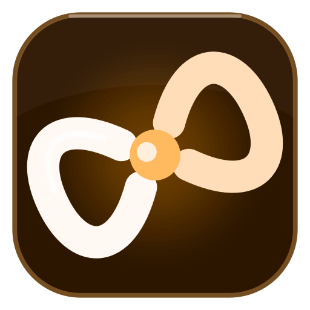
LinkBridge
Connect Beyond Limits

Your Android phone and your PC, working as one.

Notifications, messages, calls, clipboard, files, photos, screen mirroring and
phone apps in windows, between Android and Windows 10 (2004+) or 11. Free and open source.
Local-first, end-to-end encrypted, no account and no cloud.

Hi, I'm Bee, and yes, a bee built an app called LinkBridge. I build cool stuff
in the open on 𝕏 @thtbee_, so come see what's next.
Feedback, bugs or ideas? DM me directly.

CI

 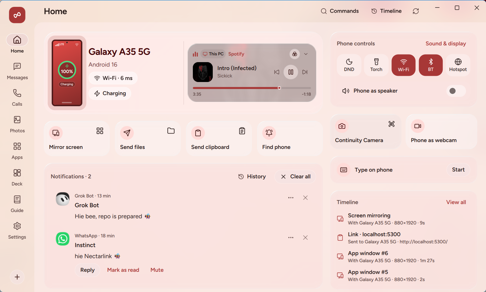 

Why LinkBridge
LinkBridge came out of my own frustration. I kept juggling Phone Link for
notifications and messages, KDE Connect for the clipboard and LocalSend for
files, and always wanted one app that did all of it. So I made one.

It covers what those three did for me, with one app on each side, plus a lot
of new features I wanted that I think you'll enjoy having too.

Download & Platform Status
Platform	Status	Output / Package Location	System Requirements
Windows (x64)	Ready	Download Windows Setup	Windows 10 (2004+) or 11, 64-bit Intel/AMD
Android Mobile	Ready	Download Android APK	Android 8.0 (API 26) or newer
Windows (ARM64)	Automated in CI	Built via GitHub Actions workflow (.github/workflows/ci.yml)	Windows 11 on ARM (Snapdragon / ARM64)
Linux (x86_64)	Automated in CI	Built via GitHub Actions workflow (.github/workflows/ci.yml)	Ubuntu 24.04+, Debian 13, Fedora 40+
Running the Windows Application Locally
You can run LinkBridge Desktop directly from the staged bundle:

.\target\package\Nectarlink\LinkBridge.exe
Installing the Android Application
Install the built debug APK onto a connected Android device or emulator via ADB:

adb install -r android/app/build/outputs/apk/debug/app-debug.apk
Windows ARM64 and Linux Packages (CI Builds)
Windows ARM64: Requires MSVC ARM64 C++ tools and Qt ARM64 cross-compilation binaries (win64_msvc2022_arm64_cross_compiled). Configured and automated under the desktop-arm64 job in GitHub Actions.
Linux Packages (.deb, .rpm, AppImage, .tar.gz): Native Linux packaging tools (dpkg-deb, rpmbuild, appimagetool, and Linux shared libraries) run on Ubuntu runners via the desktop-linux and linux-install GitHub Actions workflows.
The apps update themselves from GitHub Releases and check every download
against its SHA-256 sums.

On Linux
From the next release, one command installs LinkBridge with everything it
needs, and shows each step as it goes:

curl -fsSL https://github.com/thtbee/nectarlink/releases/latest/download/install.sh | sh
It picks the package for your system (.deb with apt, .rpm with dnf or zypper,
the tarball elsewhere), checks it against the release's SHA-256 sums and
installs it with its dependencies. Then it sets up the phone as a webcam, the
phone as a keyboard and mouse, and the firewall for your local network only.
To remove it all again, end the same command with sh -s -- --uninstall
instead of sh. See Installing on Linux
for the details.

[!NOTE]
SmartScreen may warn about the Windows installer the first time, because it
isn't code-signed yet: choose More info, then Run anyway. On Android,
allow your browser or file manager to install apps when asked.

[!IMPORTANT]
In India and many other countries, Google Play Protect blocks the APK with
no Install anyway button. Pause Scan apps with Play Protect while you
install it (Play Store › your profile › Play Protect › Settings), then turn it
back on, or install it from a PC with adb install. See
Play Protect blocks the APK.

Get started
Install LinkBridge on your PC and on your phone.
On the PC, the setup walkthrough shows a QR code. Scan it with the phone
(from the LinkBridge app or any camera app), or pick the PC from the phone's
list of nearby devices and compare a 6-digit code. A USB cable works too.
Allow what you want to share. Every feature has its own switch per device,
and the sensitive ones are off until you turn them on.
Optional: set up Wireless debugging once in the phone app for the
features Android reserves for privileged apps (phone apps in windows, real
touch input, background clipboard sync). No root, nothing else to install.
The user guide walks through every step and feature.

What it does
Stay on top of your phone

Notifications on the PC, with replies, actions, Live Updates (progress,
timers, deliveries) and a Copy code button for one-time codes. Clear on
one side, cleared on the other.
Messages: SMS and MMS conversations plus chats from RCS, WhatsApp,
Telegram, Signal and other apps in one inbox. Reply, send pictures, start
new conversations.
Calls: see who's calling, answer, decline or hang up from the PC, call
any number or contact through the phone, and browse recent calls.
Move things between devices

Clipboard: copy on one device, paste on the other, with optional
encrypted history. Passwords from password managers are never sent, and
one-time codes are never kept in the history.
Files and folders both ways at Wi-Fi speed, with resume after a dropped
connection, Send to in File Explorer, and the phone's storage in File
Explorer.
Photos: the phone's camera roll, screenshots and albums on the PC.
Handoff: links, maps and videos (at the same timestamp) open on the
other device.
Use your phone from the PC

Screen mirroring at up to 60 frames a second with the phone's sound,
screenshots and recording.
Apps: open any phone app in a window of its own on the PC, with its own
taskbar icon, running beside whatever the phone shows.
Type on the phone with the PC keyboard, without mirroring.
Phone controls on the PC: Do Not Disturb, ringer, volume, flashlight,
brightness, Wi-Fi and Bluetooth.
Use your PC from the phone

Touchpad, air mouse, keyboard, voice typing and presentation remote.
Deck: a Stream Deck style grid of buttons for the PC (media, shortcuts,
apps, OBS Studio, commands), with live volume and mute.
Lock, sleep and wake the PC.
Camera and sound

Phone as a webcam in Zoom, Teams, Meet, OBS and the Camera app.
Continuity Camera: take a photo or scan a document with the phone and
have it on the PC's clipboard.
Phone as a speaker for the PC's sound, and a voice recorder that
saves straight to the PC.
And more: media controls both ways, battery alerts, Find my device, a
searchable Timeline of everything that moved, a Command Palette
(Ctrl+Alt+Space), a slide-out Shelf, a home-screen widget, and a
Connection Doctor that finds and fixes what keeps devices from connecting.
Four themes, Hive, Bloom, Glass and Graphite, each in light
and dark.

Platform support
Feature	Windows	Linux	macOS (Preview)
Pairing & mutual TLS	Yes	Yes	Yes
Files & folder transfer	Yes	Yes	Yes
Photos browser & download	Yes	Yes	Yes
Continuity Camera	Yes	Yes	Yes
Calls & SMS viewer	Yes	Yes	Yes
Phone quick toggles & volume	Yes	Yes	Yes
Clipboard text & image sync	Yes	Yes	Yes (two-way text, incoming photo)
System notifications	Yes	Yes	Yes (system banners)
Phone screen mirroring	Yes	Yes	Not yet (in development)
Screen recording (MP4)	Yes	Yes	Not yet
PC audio stream / phone mic	Yes	Yes	Not yet
Phone as webcam	Yes	Yes (with v4l2loopback)	Not yet
Phone storage in the file manager	Yes	Yes	Not yet
Private by design
Local-first. Devices talk directly over your network or a USB cable.
Nothing goes through a server, and there's no account.
End-to-end encrypted. Every connection is QUIC with TLS 1.3, authenticated
with device keys exchanged when you pair. Keys are protected by Windows DPAPI
and the Android Keystore.
You decide what's shared. Each paired device has its own feature
switches. Remote control of the PC, shell commands and phone storage are off
until you allow them.
The only internet traffic is the update check against GitHub Releases
(which you can turn off), and, if you turn it on, Connect over mobile
data, which relays encrypted traffic it can't read.
Details: Privacy and security and the
security model.

Screenshots
Hive is an exclusive theme: honey, with a living honeycomb that breathes
behind the app.

Hive, light	Hive, dark
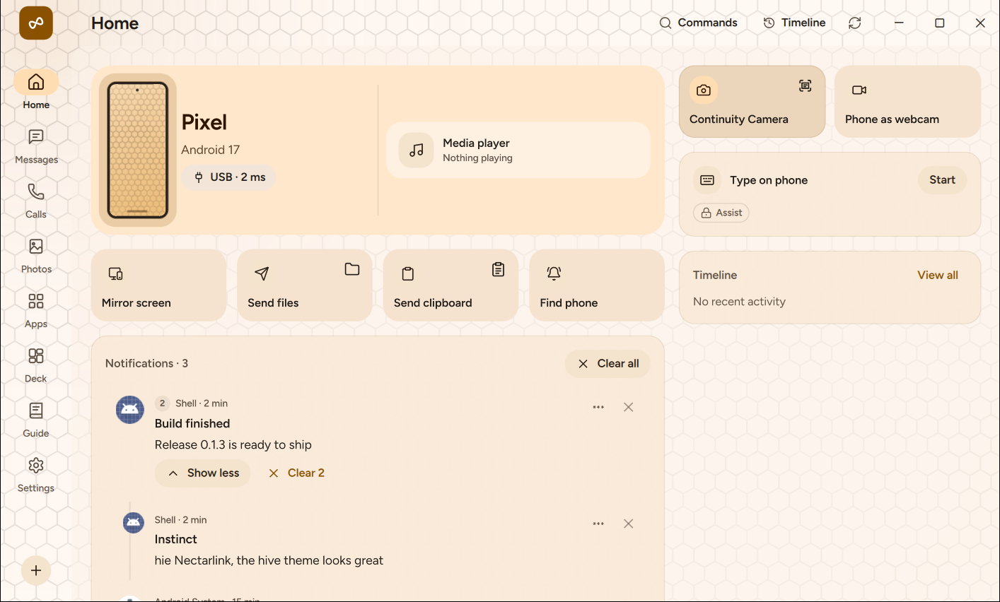	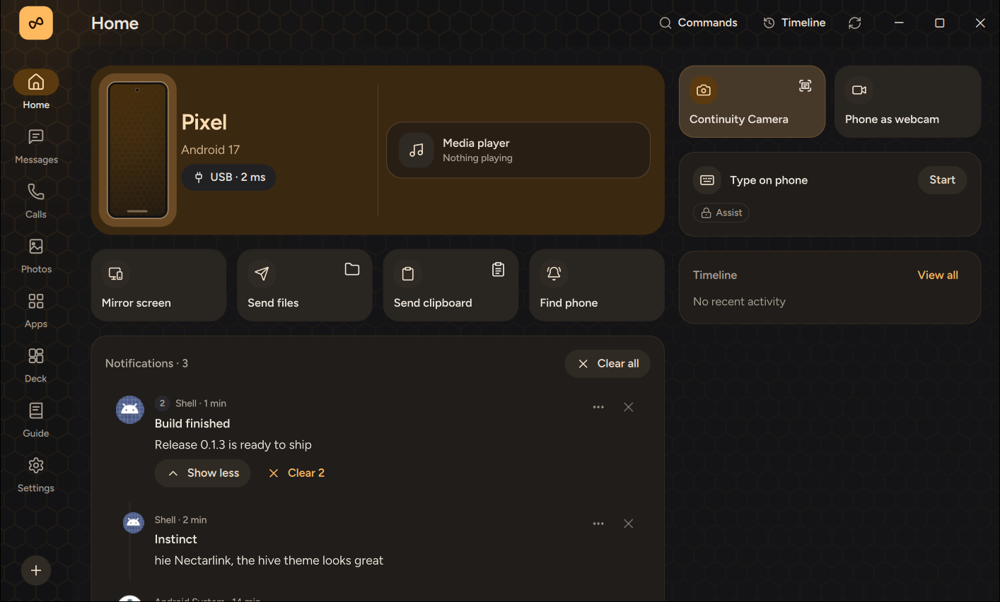
Also Bloom, soft and colorful; Glass, translucent cards over the
Windows backdrop; and Graphite, ink on paper. All in light and dark.

Bloom	Glass	Graphite
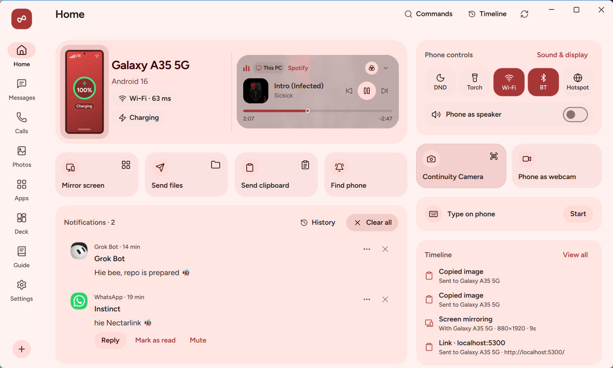		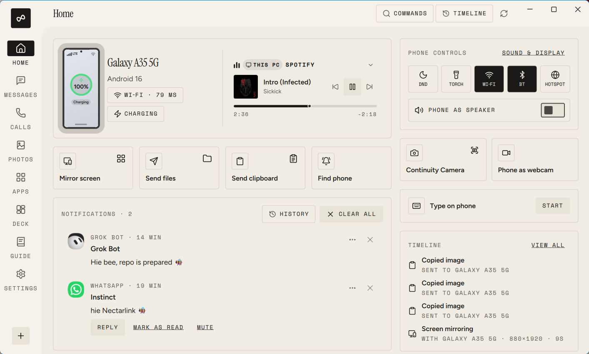
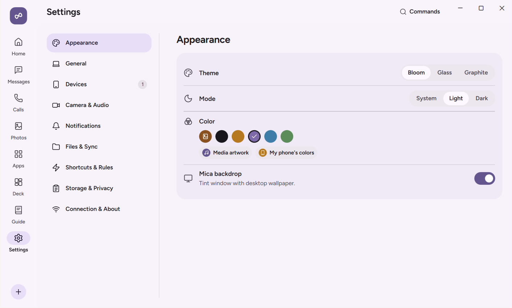	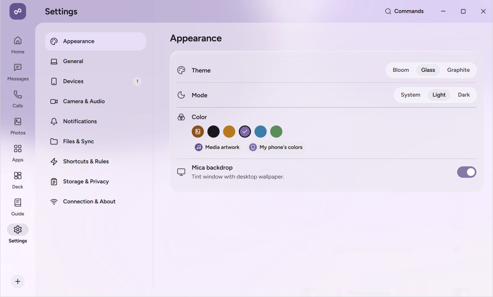	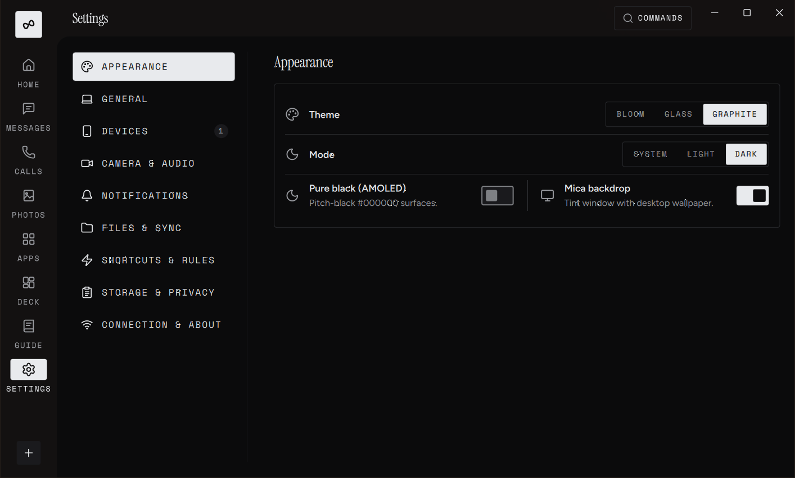

 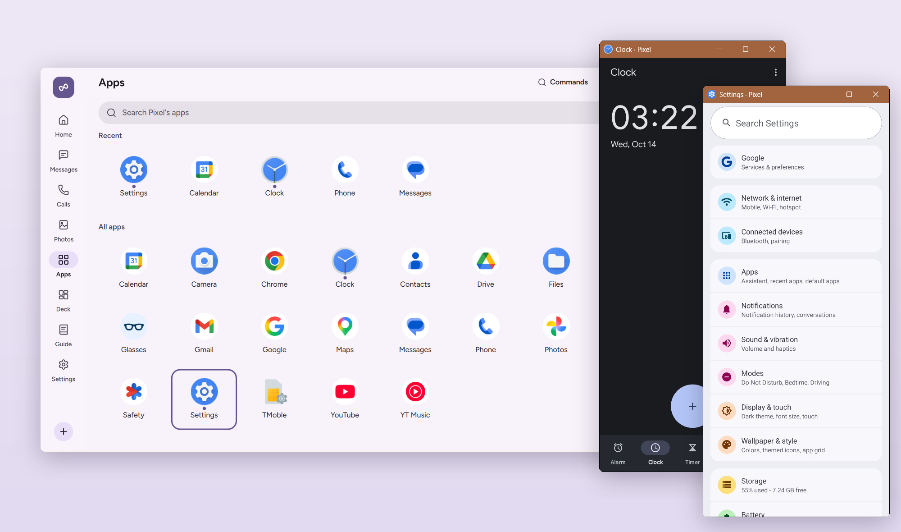  The phone's apps on the PC, each in a window of its own. 

 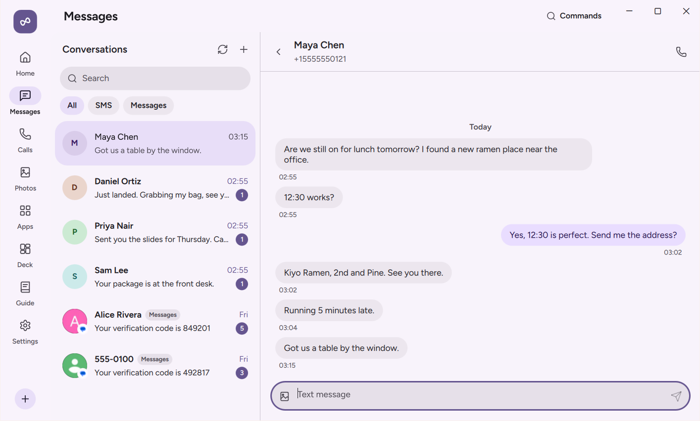  The phone's texts on the PC. 

 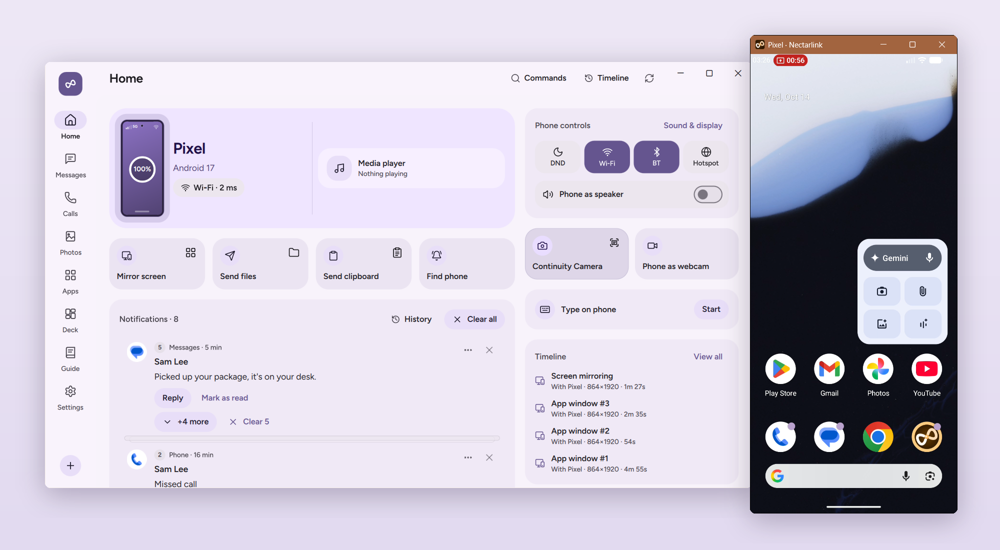  The whole phone screen in a window, with mouse and keyboard control. 

 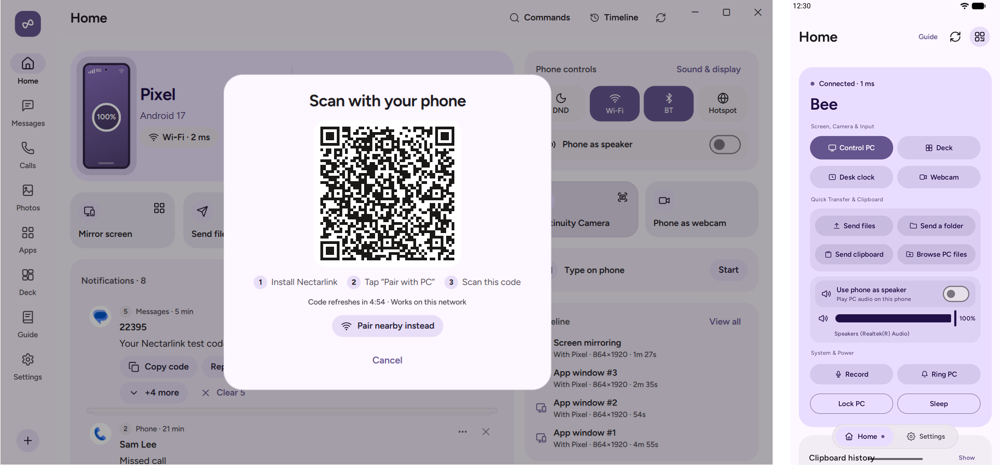  Pairing by QR code, and the Android app once connected. 

How it works
 Android app (Kotlin, Compose)            Windows app (Qt Quick, Rust)
          │ UniFFI                                │ cxx-qt
          ▼                                       ▼
 ┌─────────────────────┐   QUIC (iroh),   ┌─────────────────────┐
 │  nectarlink-core    │◄────────────────►│  nectarlink-core    │
 │  pairing, sessions, │  end-to-end      │  pairing, sessions, │
 │  storage, features  │  encrypted       │  storage, features  │
 └─────────────────────┘                  └─────────────────────┘
One core, two apps. Protocol, pairing, sessions, the trust store and the
capability matrix live in Rust (core/) and run unchanged on both platforms.
Native on both sides. A Windows 11 app built with Qt Quick and Rust, and
an Android app built with Jetpack Compose.
Capability matrix. Both apps work out which features a pair of devices
supports and what would enable the rest, so the interface never offers
something that can't work.
Protocol. Versioned and documented in v0.md:
length-prefixed CBOR messages on QUIC streams.
Repository layout
core/
  nectarlink-protocol/   Message types, framing, pairing cryptography      (MPL-2.0)
  nectarlink-core/       Identity, trust store, pairing, sessions, features (MPL-2.0)
  nectarlink-ffi/        UniFFI bindings used by the Android app          (MPL-2.0)
  nectarlink-adb/        Wireless debugging client for the phone's helper  (MPL-2.0)
  nectarlink-cli/        Command-line client (`nectarlink`)                (GPL)
desktop/
  app/                   Windows app: Rust host, cxx-qt bridge, QML UI     (GPL)
  vcam/                  Windows 11 virtual camera Media Foundation DLL    (GPL)
  installer/             NSIS installer script and Sparse Package manifest (GPL)
android/                 Android app: Kotlin and Jetpack Compose (API 26+) (GPL)
assets/fonts/            Fonts both apps ship with                         (OFL-1.1)
assets/brand/            The app icon (see the trademark policy)
tools/xtask/             Code generation (theme tokens) and checks         (GPL)
spikes/                  Technical experiments with their results
scripts/                 Build, packaging and check scripts
docs/                    Guide, technical docs, protocol, design system    (CC BY 4.0)
Building from source
Part	Needs
Core and CLI	Rust (stable, pinned in rust-toolchain.toml)
Windows app	Windows 11, Visual Studio 2022 Build Tools (C++), Qt 6.12 for MSVC 2022 x64
Linux app	Ubuntu 24.04 or newer (glibc 2.39), a C++17 compiler, pkg-config, the X11, Wayland and D-Bus development packages, Qt 6.12 (gcc_64, with Qt Shader Tools and Qt Wayland Compositor)
macOS app	macOS 14+, Xcode Command Line Tools, Qt 6.12 (or Homebrew Qt 6)
Android app	Android SDK (platform 37, NDK 30.0.16248370), JDK 17 or newer, cargo-ndk (see README.md)
For Linux hardware video encoding and decoding, install libavcodec-dev and
libavutil-dev before building. The backend loads the matching FFmpeg runtime
libraries when needed and tries available GPU drivers. Release packages support
FFmpeg 6 through 9: the Ubuntu 24.04 release build includes an FFmpeg 6 backend,
and separate adapters support versions 7, 8 and 9. Source builds use the
matching runtime for their headers. Without matching libraries or a working
hardware backend, the existing software H.264 path remains available. HEVC
encoding requires hardware; if unavailable, screen sharing falls back to H.264.

cargo test -p nectarlink-protocol -p nectarlink-core -p nectarlink-ffi   # core and tests
cargo run -p nectarlink-cli -- --help                                     # command-line client
cargo run -p nectarlink-desktop                                           # Windows app (Qt's bin on PATH)
cd android && ./gradlew assembleDebug                                     # Android app
./scripts/package.ps1    # Windows installer: target\package\Nectarlink-<version>-x64-setup.exe
./scripts/check.ps1      # every check CI runs; add -Android and -Arm64 for the full set
Releases are built by CI from a v* tag; see
releasing.md.

Documentation
User guide: setup, pairing and every feature, on Windows and Android
Technical documentation: architecture, security model, protocol, storage, performance and builds
Protocol v0 and the capability registry
Architecture decision records and the design system
Project plan and roadmap
Questions and ideas
Ask questions, share ideas and show your setup in
Discussions. Issues are for
bugs and agreed feature work.

Contributing
Contributions are welcome. Please read CONTRIBUTING.md first;
for anything larger than a small fix, open an issue to agree on the approach.
Contributions are accepted under the Developer Certificate of Origin,
and everyone is expected to follow the Code of Conduct.

To translate LinkBridge into your language, see
translating.md.

To report a security issue, follow SECURITY.md. Please don't
open a public issue.

License
Windows and Android apps, CLI: GPL-3.0-or-later,
with an app-store exception
Core libraries: MPL-2.0
Protocol specification and documentation: CC BY 4.0
See LICENSE for which license applies where. The LinkBridge name and
logo are covered by the trademark policy.

